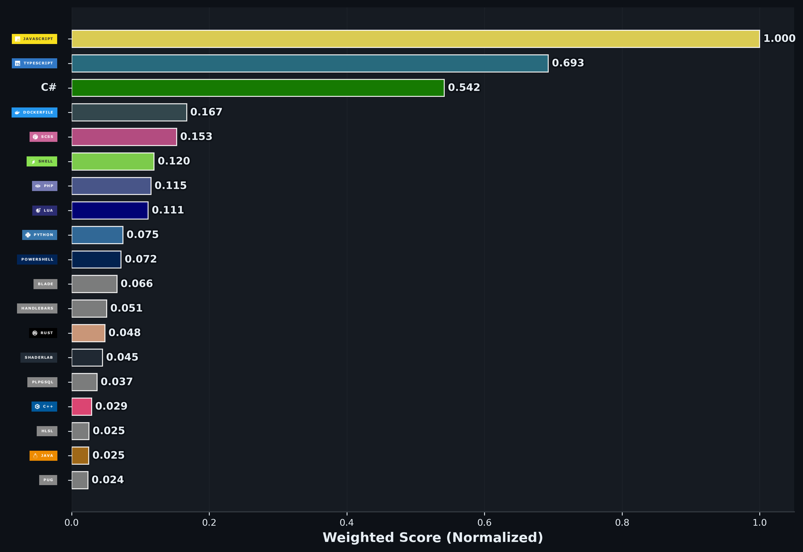

# Lucas Reis

**Desenvolvedor Full-Stack** · React · Next.js · TypeScript · NestJS

Web, mobile, IoT e jogos · Santa Fé do Sul, SP

---

### Sobre mim

Desenvolvedor full-stack com foco em front-end React e Next.js, atuando também em APIs NestJS, apps React Native e integrações IoT. Gosto de código organizado em Clean Architecture, tipagem forte e produtos que chegam de fato ao usuário.

- 💼 **Especialista em Desenvolvimento de Software** na [FITec](https://www.fiteclabs.org.br), desde 2023
- 🧊 **Fundador e Desenvolvedor** da [Aura Cubic Digital](https://auracubicdigital.com.br), startup de desenvolvimento de aplicações
- 🎓 Cursando Engenharia de Software na UNIASSELVI · Técnico em Desenvolvimento Web pela TreinaWeb

---

### Experiência

**FITec** · Especialista em Desenvolvimento de Software · 2023 até hoje

- **CLAMPER Mobi Smart:** plataforma IoT para gestão de recarga de veículos elétricos. Portal em Next.js 15 e React 19 com Clean Architecture, APIs NestJS com MQTT e JWT, app React Native com notificações push e geolocalização.
- **Acer Conecta:** migração do front-end de React JS para React com TypeScript, Vite e Ant Design, com CI/CD em AWS CodePipeline.
- Soluções com reconhecimento de placas veiculares usando IA.

**Aura Cubic Digital** · Fundador e Desenvolvedor

- Produtos próprios, como o Aura Cubic CRM e o Mistura Certa, e sistemas sob medida para clientes.

**Freelancer** · desde 2022

- Jogo 2D em Unity/C# usado no stand da **Seven Boys** na **Campus Party Brasil**.
- Globo 3D interativo com **Three.js** e Laravel para a **DTCOM**, mostrando as confederações de futebol pelo mundo.
- Sistema para médicos em React com cadastro de pacientes, prontuários e monitoramento de Covid.

---

### Projetos

**Públicos**

| Projeto | Descrição | Stack |
|---|---|---|
| [Aura Questor](https://github.com/lucascodev/aura-questor) | Rastreador de objetivos para World of Warcraft: missões, conquistas e mais, em uma janela própria | Lua |
| [Aura Nameplate](https://github.com/lucascodev/aura-nameplate) | Addon de WoW que mostra na placa do alvo a magia que você acabou de conjurar (em desenvolvimento) | Lua |
| [Portfólio](https://github.com/lucascodev/portfolio-lucascodev-profile) | Portfólio profissional responsivo com Clean Architecture e Framer Motion | Next.js 16, TypeScript |
| [Prompt Manager](https://github.com/lucascodev/nextjs-prompt-manager) | Gerenciador de prompts para uso com IA | Next.js 15, Prisma, PostgreSQL |
| [Laravel API Auth](https://github.com/lucascodev/laravel-api-authentication-demo) | API REST com UUID, autenticação Sanctum e documentação OpenAPI | Laravel 11, PHP |
| [Lambda Common Name](https://github.com/lucascodev/lambda-get-common-name) | AWS Lambda que extrai o Common Name (CN) de um certificado PEM | Node.js, AWS |
| [Let Me Ask](https://github.com/lucascodev/let-me-ask-app) | Salas e perguntas em tempo real, feito no NLW Agents da Rocketseat ([API](https://github.com/lucascodev/let-me-ask-api)) | React, Fastify, Drizzle |

**Aura Cubic Digital** (código em repositórios privados)

| Produto | Descrição | Stack |
|---|---|---|
| [Aura Cubic CRM](https://auracubiccrm.com.br) | CRM por assinatura para empresas que vendem por WhatsApp, telefone e indicação: funil visual, propostas em PDF, follow-up automático e equipes com permissões | NestJS, monorepo, TypeScript |
| Mistura Certa | Plataforma de receitas com gamificação, com web, app mobile e API | Next.js 16, React Native, NestJS, Prisma |
| Aura Monitor | Monitoramento de hardware em tempo real: agente desktop, API e dashboard com modo kiosk | Tauri, React, NestJS, Socket.IO, Flutter |
| Aura Deck | App mobile de stream deck, mídia e métricas do Aura Monitor pela rede local | React Native, Expo |
| Aura Pipeline | Painel de deploy que roda na sua máquina, com execução local, por SSH ou por agente | TypeScript |
| Aura Crypto Miner | Tycoon de mineração de criptomoedas em 3D isométrico | Unreal Engine 5, C++ |

---

### Stack

**Front-end**

**Back-end**

**Mobile e desktop**

**Dados e mensageria**

**DevOps e qualidade**

**Jogos**

---

### Certificações

| Certificação | Emissor | Ano |
|---|---|---|
| [🏅 GitHub Copilot](https://www.credly.com/badges/e2c31236-1d1a-4b0b-a9d0-e2660ca74df4/linked_in_profile) | GitHub | 2025 |
| GitHub Copilot Challenge | Microsoft | 2025 |
| NLW Agents: Avançado | Rocketseat | 2025 |
| Carreira IA: do zero ao primeiro agente automático com n8n | Rocketseat | 2026 |

---

### Contribuições

<picture>
<source media="(prefers-color-scheme: dark)" srcset="https://raw.githubusercontent.com/lucascodev/lucascodev/outputs/github-snake-dark.svg" />
<source media="(prefers-color-scheme: light)" srcset="https://raw.githubusercontent.com/lucascodev/lucascodev/outputs/github-snake.svg" />

</picture>

---

### Contato

